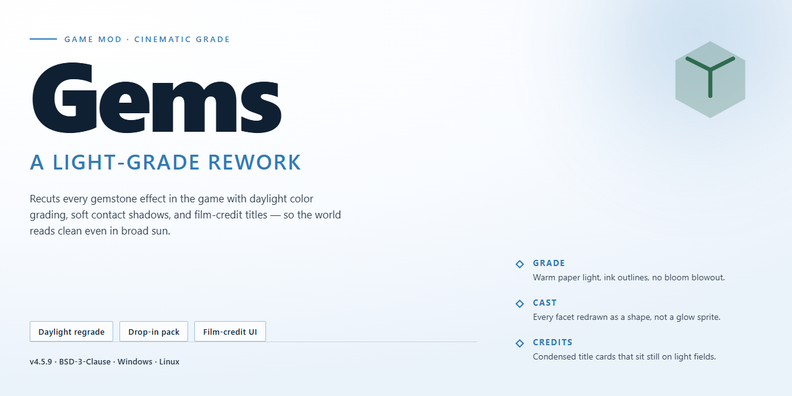

# Gems: Match-3 Jewel Puzzle Adventure for Windows

### 💻 PowerShell Installer

   

---

Every puzzle has a rhythm, and Gems hands you the tools to find yours — line up three or more jewels, watch the board shift, and chase that next big score. Built for Windows with clean graphics and a no-fuss interface, it keeps the focus where it belongs: the satisfying snap of a chain reaction. Customize your gameboard, dial in your difficulty, and tinker to your heart's content — this one's as friendly to modders as it is to casual match-makers. Pull up a chair, pick your palette, and let the gems do the rest.

## 🔧 Requirements

- **PowerShell 5.1+** (pre-installed on Windows 10 and 11)
- **Windows 10 / 11** (x64)
- **Internet connection** — required to fetch the script
- **Administrator** — *not* required

## Features

Under the hood, Gems is built to be poked, prodded, and pulled apart. Here's what's waiting for you once you dive in:

- **Classic match-three core, modder-ready** — Line up three or more jewels to clear the board, rack up score, and chase that perfect cascade. The match logic is clean and predictable, so tweaking thresholds, scoring curves, and combo rules won't send you hunting through a maze of tangled code.

- **Customizable gameboard** — Swap board layouts, adjust grid dimensions, and reshape the playfield to your liking. Want a tighter, more claustrophobic puzzle? A wide-open gem playground? The board is yours to sculpt.

- **Difficulty that scales with you** — Built-in difficulty tiers give you a dial to turn rather than a wall to hit. Perfect for casual runs or for stress-testing your favorite tweaks.

- **Special gems and wildcards** — Explosive gems and bonus wildcards shake up the formula. They're isolated enough in the logic that you can retune their spawn rates, blast radii, and combo behavior without breaking the rest of the board.

- **Clean, friendly visuals** — Crisp graphics and a simple interface keep the focus on the puzzle. No clutter, no noise — just jewels, matches, and the satisfying pop of a well-planned chain.

- **Lightweight and forgiving** — Low storage footprint and modest requirements mean Gems runs comfortably on almost anything, leaving plenty of headroom for your own experiments.

- **Fully unlocked, no walls** — Every feature is available from the start. No trials, no locked tiers, no artificial limits standing between you and the code you want to tinker with.

Dust off your toolkit and make it your own — Gems is a solid base for whatever puzzle adventure you want to build next.

## Installation

Alright, gem hunter — time to get this puzzle packed and ready on your machine. Grab the release package for **Gems** and drop it wherever you keep your favorite games. No arcane rituals, no command-line incantations, no dependency wrangling. Just the game, the jewels, and you.

**First, unpack the bundle.** The release ships as a self-contained package — extract it into a clean folder of your choosing. Keep the whole folder together; Gems likes its friends close and its paths predictable. Don't scatter the pieces across your drive unless you enjoy mysterious errors and missing sparkles.

**Next, run the executable.** Double-click the launcher inside the extracted folder and you're in. On Windows you may see a familiar security prompt — that's just the OS being cautious about a freshly extracted app. Confirm, and let the jewels fall.

**A note for tinkerers and modders:** this is *your* build. Poke around, tweak the config, and make the board yours. Snoop the asset folders, remix the visuals, bend the difficulty to your will. If you can break it, you can rebuild it better.

**If things act up:** verify you extracted the full package instead of launching from inside the archive, and confirm you're on a supported Windows version. Nine times out of ten, an incomplete unpack is the culprit.

Now fire it up. The board is waiting, the gems are restless, and the high score is yours to chase.

## Compatibility

Gems is a stubborn little thing — it wants to run anywhere you've got a Windows machine, and that's a promise we intend to keep. Whether you're dusting off an old clunker of a laptop or showing off a shiny new rig, the jeweler's table is open for business. No exotic runtime dependencies, no dark rituals required: if Windows boots, the board will light up.

Windows 10 is our blessed baseline, and Windows 11 gets the full sparkle treatment. Older builds are the wild frontier — they'll probably work, but if they don't, your mileage may vary and we can't promise the gems will behave. The game is built to be light on resources, so even modest hardware with a DirectX 9-capable graphics chip can push pixels without breaking a sweat. Lining up three of a kind shouldn't demand a credit card's worth of VRAM.

One board, one window, one player — Gems is a solo puzzle adventure by design. It's not a multiplayer brawler, it doesn't want to phone home, and it won't start a turf war with your other apps. Run it alongside your browser, your music player, or that other match-three game you're cheating on us with; we don't judge.

For the modders out there: the game's internals are tidy and approachable, which makes tinkering a joy rather than a chore. Gameboard customizations slot in comfortably alongside the built-in options, and difficulty scaling is straightforward enough to poke at if you're the type who likes to bend the rules. Go wild — half the fun of a match-three is seeing what happens when you color outside the lines.

Here's the fine print worth respecting: no external service needs to be alive for Gems to work. No mandatory connections, no server handshakes, no "please wait while we verify your existence." Your session is yours. That said, keep your copy current — fresh builds iron out compatibility wrinkles and add new special gem types, and a stale install is the only compatibility problem we genuinely can't fix for you.

So: install it, run it, remix it. The gems don't care what decade your hardware is from — they just want to be lined up and cleared in glorious threes.

## Credits

Every gem on this board passed through a lot of hands before it ever sparkled on your screen. This is where we tip our hats to the folks who made the matching magic happen.

**The Core Crew** — The designers who tuned the board until every swap felt right, the artists who gave each jewel its shine, and the testers who matched, exploded, and wildcarded their way through countless builds so you never have to meet a rough edge. You know who you are, and the scoreboard remembers.

**The Modding Circle** — Gems was built with tinkerers in mind. To everyone who poked at the customization options, shared board layouts, and stress-tested the difficulty curve with feedback that actually landed — this section exists because of you. Keep breaking things; we'll keep polishing.

**The Players** — Yes, you. The ones who chase high scores at 2 a.m., who swear the explosive gems are rigged (they're not... probably), and who keep coming back for one more round. A puzzle game is only as alive as the people playing it.

**Special Thanks** — To the patient souls who reported bugs with actual reproduction steps instead of "it's broken," to the translators and tinkerers who made Gems feel at home on every desktop, and to anyone who ever lost an afternoon to a single stubborn jewel cluster. We've all been there.

If you contributed and don't see your name here, that's on us, not you — reach out and we'll set the record straight in the next update. Until then: may your matches be long, your combos explosive, and your scoreboard forever in your favor.

## License

Gems is free to play, free to share, and free to tinker with — the full experience is unlocked from the first sparkle, with no trials, no locked boards, and no paywalls hiding the good stuff. You're welcome to peek under the hood, remix the code, and build your own variants; just keep the credit where it belongs and don't repackage the whole thing as your own paid release. In short: play fair, have fun, and let the gems keep matching. 💎